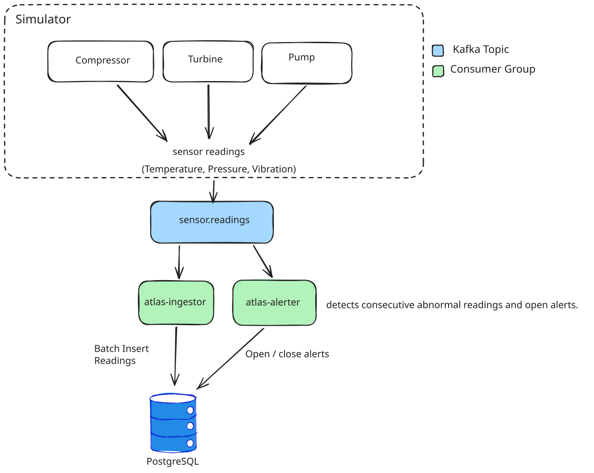

# Atlas 

An equipment telemetry pipeline in Go: simulate industrial sensors, store readings, and detect sustained faults.

**Stack:** Go · Kafka (KRaft) · PostgreSQL · franz-go · pgx · sqlc · goose · Docker Compose

## Architecture



`sensor.readings` lives in Kafka; the simulator publishes to it. The alerter both opens and closes alerts.

## Done

- **3 machines × 3 metrics:** compressor, pump, turbine; temperature, pressure, vibration.
- **9 readings per tick**, with a 3-second interval and simulated fault streaks.
- Equipment-keyed messages across **3 Kafka partitions**; **2 independent consumer groups**.
- Batch ingestion: up to **1,000 records per poll**, duplicate-safe inserts, retries, and commits after DB writes.
- Alerts after **3 consecutive breaches**; recovery closes them; startup restores open alerts.
- SQL migrations, generated queries, structured logging, shutdown handling, and unit tests.


## Left

- HTTP API: equipment, reading history, aggregates, and open alerts.
- React dashboard: charts, equipment health, and alerts.
- AI query agent: ask about telemetry in natural language.
- Kafka alert notifications (`equipment.alerts`) and a dead-letter topic for invalid readings.
- Rebalance state handling and stronger alert replay safeguards.
- Automated Kafka/Postgres integration tests and throughput benchmarks.


## Run locally

Requires Go 1.26.4+, Docker Compose, and the goose CLI. sqlc is needed only to regenerate queries.

```sh
cp .env.example .env
docker compose up -d
make migrate-up
go test ./...
```

Run each program in a separate terminal:

```sh
go run ./cmd/simulator
go run ./cmd/ingestor
go run ./cmd/alerter
```

Inspect messages and consumer lag in [Kafka UI](http://localhost:8080). Check alert recovery:

```sh
docker compose exec postgres psql -U postgres -d atlas -c 'SELECT * FROM alerts ORDER BY id DESC LIMIT 10;'
```

**Current limits:** local single-broker setup; breach counts reset on restart. Reading inserts deduplicate by event ID; historical alerts can repeat on replay.